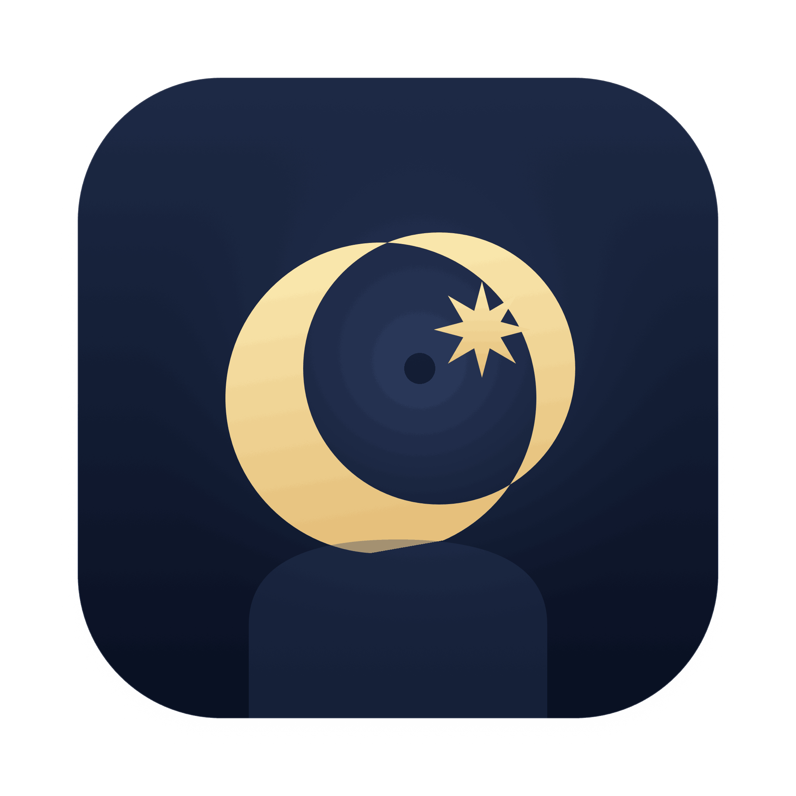
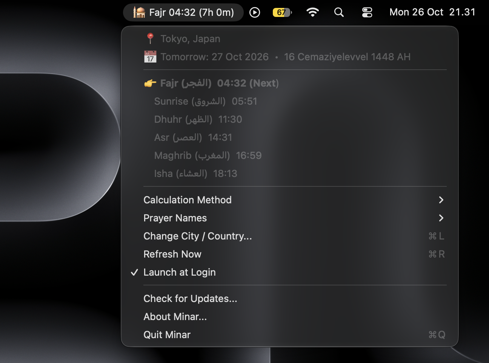

<div align="center">



# Minar (مَنَارَة)
### Elegant, Distraction-Free Islamic Prayer Times for Mac & Mobile

**Minar** is a unified suite of battery-first Islamic prayer time applications designed to keep Salah at the heart of your day — always accessible, never distracting.

<p align="center">
  <a href="#-minar-for-macos-menu-bar"><b>Minar for Mac</b></a> •
  <a href="#-minar-for-mobile-android--ios"><b>Minar for Mobile</b></a> •
  <a href="#-repository-structure"><b>Architecture</b></a> •
  <a href="#-releases--versioning"><b>Releases</b></a>
</p>

---

</div>

## 🖥️ Minar for macOS (Menu Bar)
Located in [`apps/macos-menubar/`](apps/macos-menubar)

A native Swift 5.9+ macOS menu bar app that sits quietly in your menu bar with a live countdown to the next prayer.

<div align="center">
  
</div>

* **Always-Visible Countdown**: Live countdown timer updated every minute with zero battery overhead.
* **Six Daily Prayers**: İmsak (Fajr), Güneş (Sunrise), Öğle (Dhuhr), İkindi (Asr), Akşam (Maghrib), and Yatsı (Isha).
* **Official Diyanet Times**: Official timings from the Turkish Directorate of Religious Affairs with instant district search.
* **Fallback Calculation Methods**: Muslim World League, ISNA, Umm Al-Qura, Egyptian Authority.
* **Native & Lightweight**: Built purely with native AppKit & Swift Concurrency — no Electron, no browser engine.

```bash
# Build & Run macOS App
cd apps/macos-menubar
swift run Minar
```

---

## 📱 Minar for Mobile (Android & iOS)
Located in [`apps/mobile/`](apps/mobile)

A Flutter mobile app crafted for battery efficiency, sharp typography, and native home screen widgets.

* **Android Home Screen Widgets**:
  * **Daily Timetable (4×2)**: 6-prayer grid with bold times and gold active prayer indicator.
  * **Vertical Schedule (4×3)**: Vertical timetable matching in-app schedule with subtitle transliterations.
  * **Minimal Bar (4×1)**: Single-row horizontal strip for compact home screens.
  * **Next Prayer Hero (2×2)**: Large prayer name, countdown badge, and Hijri date.
* **Swipeable 8-Day Schedule**: Smooth horizontal day paging with auto-centering date pill selector (`Today`, `Tomorrow`, `Fri 27`...).
* **Notification Shade Table**: Silent, pinned prayer card in Android notification shade that automatically switches to tomorrow's schedule after Isha.
* **Battery First**: One 2 KB weekly fetch powers 8 days completely offline with zero background polling.

```bash
# Run Mobile App
cd apps/mobile
flutter run
```

---

## 📂 Repository Structure

```text
Minar/
├── apps/
│   ├── macos-menubar/             # Swift 5.9 native macOS Menu Bar application
│   │   ├── Package.swift
│   │   ├── Sources/
│   │   ├── Resources/
│   │   └── scripts/
│   │
│   └── mobile/                    # Flutter Android & iOS application
│       ├── pubspec.yaml
│       ├── lib/                   # Flutter UI & business logic
│       ├── android/               # Native Android layouts, receivers & widgets
│       ├── ios/                   # Native iOS runner
│       └── test/                  # Unit test suite
│
├── shared/
│   ├── branding/                  # Shared icons, logos, and color palettes
│   └── docs/                      # Calculation methodology and API specs
│
├── .github/
│   └── workflows/
│       ├── macos.yml              # CI: Builds only on apps/macos-menubar/** changes
│       └── mobile.yml             # CI: Builds only on apps/mobile/** changes
│
└── README.md
```

---

## 🏷️ Releases & Versioning

Releases are tagged independently by platform:
* **macOS releases**: `macos-v1.0.6`, `macos-v1.0.7`, etc.
* **Mobile releases**: `mobile-v1.0.0`, `mobile-v1.0.1`, etc.

---

## 📄 License
MIT License. Created by [liondepierre](https://github.com/liondepierre).
